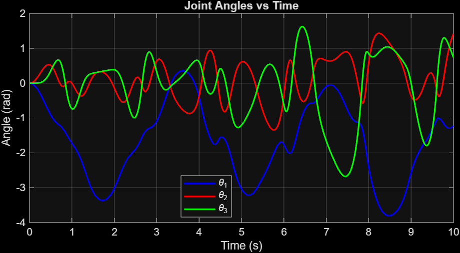
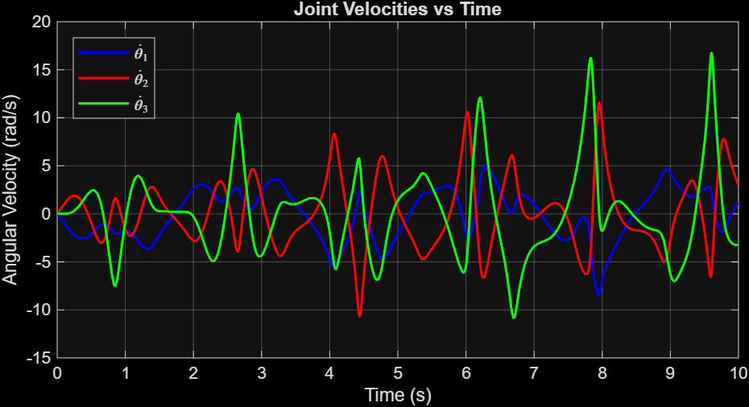
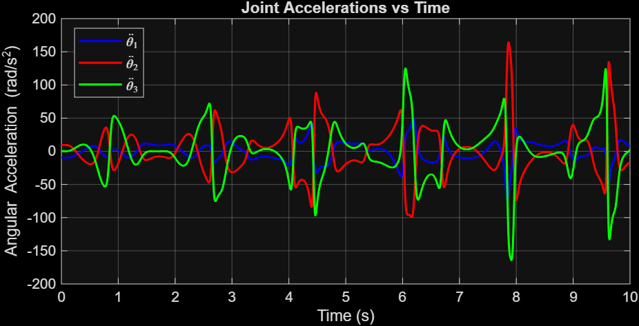

# 3R Arm Simulation Under Gravity


**ME 5250 — Robotics Mechanics and Control, Northeastern University (Fall 2025), Project 2**

A forward-dynamics simulation of a planar three-link (3R) open-chain arm falling from rest
under gravity. There are no joint torques and no friction, and a point mass sits at the tip of each link.
I derived the equations of motion from scratch with the Euler–Lagrange method and integrated them in MATLAB.

<p align="center">
  <a href="https://youtu.be/a26fu7pMk3Y">
    
  </a><br/>
  <sub>▶ <a href="https://youtu.be/a26fu7pMk3Y">Watch the animation</a></sub>
</p>

## Model

- Three revolute joints, all starting horizontal (θ = 0) and at rest
- Unit link lengths and unit tip masses (Lᵢ = mᵢ = 1), with g = 9.81 m/s² acting in −y
- With τ = 0, the dynamics reduce to

$$\ddot{\theta} = M(\theta)^{-1}\left[-c(\theta,\dot{\theta}) - g(\theta)\right]$$

## How each term is computed

| Term | Method |
|---|---|
| **Mass matrix** M(θ) | M = Σ mᵢ Jᵢᵀ Jᵢ, using the 2×3 Jacobian of each point mass, plus a 1e-4·I term for numerical conditioning |
| **Gravity vector** g(θ) | ∂P/∂θᵢ of the potential energy P = g[3 sin θ₁ + 2 sin(θ₁+θ₂) + sin(θ₁+θ₂+θ₃)] |
| **Coriolis / centripetal** c(θ, θ̇) | Christoffel symbols Γᵢⱼₖ = ½(∂Mₖⱼ/∂θᵢ + ∂Mₖᵢ/∂θⱼ − ∂Mᵢⱼ/∂θₖ), with ∂M/∂θ from central differences |
| **Integration** | Explicit Euler, dt = 2 ms, over 10 s |

The 3 sin θ₁ term reflects the chain's hierarchy: joint 1 carries all three masses, joint 2
carries two and joint 3 carries one. That's why θ₁ swings the furthest, in a pendulum-like motion.

## Results

<table>
  <tr>
    <td width="33%"></td>
    <td width="33%"></td>
    <td width="33%"></td>
  </tr>
  <tr>
    <td align="center"><sub>Joint angles</sub></td>
    <td align="center"><sub>Joint velocities</sub></td>
    <td align="center"><sub>Joint accelerations</sub></td>
  </tr>
</table>

- θ₁ moves first and furthest as the whole chain falls, while θ₂ and θ₃ swing in the opposite direction relative to it
- The motion turns chaotic within a few seconds, as you'd expect from a frictionless triple pendulum

## Running it

```matlab
simulate_3R_falling
```

This runs the simulation, opens the three plots and plays the animation.

## Files

| File | Contents |
|---|---|
| [`simulate_3R_falling.m`](simulate_3R_falling.m) | Simulation, plotting and animation (the code from the report's appendix) |
| [`Project2.pdf`](Project2.pdf) / [`Project2.docx`](Project2.docx) | Full report with the derivation of K, P, M, g and c |
| `RMC Project 2.mp4`, `RMC project 2 higher quality.mp4` | Animation recordings |
| `Angle.png`, `AngularVelocity.png`, `Acceleration.png` | Result plots |
